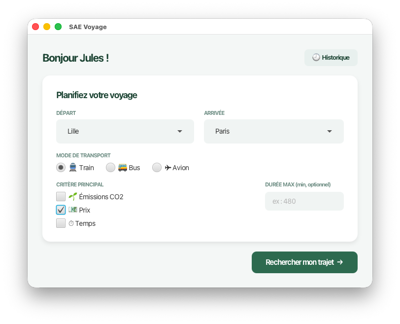

# SAÉ 2.01 & 2.02 — Assistant Personnel de Voyage Multimodal
## Rendu Partie III : Interface Homme-Machine (IHM)

---

## Équipe
* **CARAMELLE Jules** : Back-end (POO, Algorithme, Présentation)
* **HAMI Amine** : Front-end (dev JavaFX)
* **OMAR Mohammad Shafi** : Tests, validation des données gestion Git (Graphe, Figma)

---

## Aperçu de l'application



---

## Liens
* **Maquettes Figma :** [Lien Figma](https://www.figma.com/design/zncOuMWn1MpGJg2AHhgQHr/Paper-Wireframe-Kit--Community-?node-id=7601-246&t=aYGoZJvCc9AiLJ6b-1)

---

## Choix ergonomiques

L'objectif était d'avoir une interface simple, sans surcharge, et qui pousse l'utilisateur à faire des choix écologiques (principe du nudging).

**1. Guidage et Nudging (Écoresponsabilité)**
* L'interface guide l'utilisateur : choix des villes, puis des filtres.
* Même si l'utilisateur choisit de trier par "Prix" ou "Temps", le trajet qui émet le moins de CO2 est toujours mieux présnté. On affiche aussi la différence d'émission avec le pire trajet pour le faire culpabiliser un peu (ou le féliciter).

**2. Lisibilité et affichage**
* Comme demandé dans la V2, l'affichage des résultats est épuré. On n'affiche pas toutes les gares intermédiaires si l'utilisateur ne change pas de transport. On se concentre sur l'essentiel : Départ, Correspondances, Arrivée.
* Pour éviter les fautes de frappe et les erreurs `UnknownCity`, la sélection des villes se fait via des listes déroulantes basées sur le fichier CSV.

**3. Contrôle utilisateur et erreurs**
* L'utilisateur peut changer de filtre (Prix, Temps, CO2) avec de simples boutons radio : la liste se met à jour directement.
* S'il n'y a aucun trajet possible entre deux villes, l'application ne crashe pas. On intercepte l'erreur `NoPathFound` et on affiche une petite fenêtre (pop-up) pour prévenir l'utilisateur proprement.

---

## Lancement de l'application
1. Vérifiez que l'exécutable est bien dans le dossier `jar/`.
2. Ouvrez un terminal dans le dossier `jar` et lancez :
   ```bash
   java --module-path lib/ --add-modules javafx.controls,javafx.fxml -jar jar/ihm.jar